```{=typst}
#page(numbering: none, header: none)[
  #set align(center)
  #set par(justify: false)
  #v(1.2cm)
  #text(size: 14pt, weight: "bold")[TecNM — Instituto Tecnológico de Colima]
  #v(0.2cm)
  #text(size: 11pt)[Ingeniería de Datos (ATD-2602) — Grupo LCS2]
  #v(0.15cm)
  #text(size: 11pt)[Unidad III · Sesión 49]
  #v(2.6cm)
  #line(length: 70%, stroke: 1.2pt + rgb("#1f3a5f"))
  #v(0.4cm)
  #text(size: 20pt, weight: "bold", fill: rgb("#1f3a5f"))[Orquestación de datos con Cron y Prefect]
  #v(0.3cm)
  #text(size: 13pt, fill: rgb("#1f3a5f"))[Automatización de un pipeline de recopilación meteorológica mediante Open-Meteo]
  #v(0.4cm)
  #line(length: 70%, stroke: 1.2pt + rgb("#1f3a5f"))
  #v(1.6cm)
  #text(size: 12pt, weight: "bold")[Reporte técnico — Equipo 3]
  #v(2.4cm)
  #text(size: 11pt)[Profesor: M. en C. Armando Román Gallardo Heredia]
  #v(0.3cm)
  #text(size: 11pt)[Repositorio: #link("https://github.com/Leslie581/Sesion49_Equipo3_Prefect")[github.com/Leslie581/Sesion49_Equipo3_Prefect]]
  #v(1fr)
  #text(size: 11pt)[Colima, Col. — Noviembre de 2026]
]
#counter(page).update(1)
#outline(title: [Índice], depth: 2, indent: 1.2em)
#pagebreak()
```

::: {custom-style="Portada"}
**TecNM — Instituto Tecnológico de Colima**

Ingeniería de Datos (ATD-2602) — Grupo LCS2 · Unidad III · Sesión 49

**Orquestación de datos con Cron y Prefect**

Automatización de un pipeline de recopilación meteorológica mediante Open-Meteo

**Reporte técnico — Equipo 3**

Profesor: M. en C. Armando Román Gallardo Heredia

Repositorio: <https://github.com/Leslie581/Sesion49_Equipo3_Prefect>

Colima, Col. — Noviembre de 2026
:::

```{=openxml}
<w:p><w:r><w:br w:type="page"/></w:r></w:p>
<w:p><w:pPr><w:pStyle w:val="TOCHeading"/></w:pPr><w:r><w:t>Índice</w:t></w:r></w:p>
<w:p><w:r><w:fldChar w:fldCharType="begin" w:dirty="true"/></w:r><w:r><w:instrText xml:space="preserve"> TOC \o "1-2" \h \z \u </w:instrText></w:r><w:r><w:fldChar w:fldCharType="separate"/></w:r><w:r><w:t>Para mostrar el índice: clic derecho sobre este texto → Actualizar campo.</w:t></w:r><w:r><w:fldChar w:fldCharType="end"/></w:r></w:p>
<w:p><w:r><w:br w:type="page"/></w:r></w:p>
```

# 1. Introducción

Un pipeline de datos que se ejecuta todos los días no solo debe iniciar a la hora indicada: también debe reaccionar cuando una dependencia externa falla. Esta práctica compara dos formas de automatizar el mismo proceso ETL: **Cron**, el programador clásico de Unix, y **Prefect**, un orquestador de flujos escrito en Python.

El caso práctico es un pipeline que recopila, una vez al día a las 12:00 PM (hora del centro de México), las condiciones meteorológicas actuales de **Colima, Villa de Álvarez y Manzanillo** desde la API pública **Open-Meteo**. Ambos orquestadores ejecutan el mismo código ETL, con la misma política de reintentos, y escriben en un único histórico CSV. Así, las diferencias observadas se deben a la herramienta de orquestación y no a la lógica del proceso.

Todos los datos meteorológicos de este reporte son **reales**: provienen de consultas a Open-Meteo realizadas el 25 de noviembre de 2026. Lo único **simulado** son las desconexiones de red de los escenarios de fallo, que se inyectan antes de la petición HTTP para reproducir de forma controlada una caída de internet.

# 2. Objetivos

## 2.1 Objetivo general

Automatizar un pipeline real de recopilación meteorológica con Cron y con Prefect, y comparar ambos enfoques en programación, manejo de fallos, reintentos y monitoreo.

## 2.2 Objetivos específicos

1. Extraer temperatura, humedad relativa, precipitación y velocidad del viento de tres ciudades del estado de Colima desde Open-Meteo.
2. Validar, limpiar y almacenar los datos en un histórico CSV que conserve fecha, hora, zona horaria, ciudad, unidades y fuente, sin duplicados.
3. Programar la ejecución diaria a las 12:00 PM con Cron y con Prefect, considerando la zona horaria `America/Mexico_City`.
4. Implementar reintentos manuales en Cron y automáticos en Prefect, y evaluarlos en tres escenarios: normal, desconexión temporal y fallo permanente.
5. Responder los tres puntos solicitados por el profesor: matriz comparativa funcional, análisis de contingencia ante una desconexión a medianoche y comparación de reintentos manuales y automáticos.

# 3. Planteamiento del problema

Una tarea programada que depende de internet puede encontrarse con la red caída justo en el minuto en que debe ejecutarse. Si la herramienta solo sabe *cuándo* iniciar el proceso, pero no *qué hacer* si falla, el dato del día se pierde y el fallo puede pasar inadvertido. El problema se concreta en tres preguntas:

- ¿Qué ocurre con una tarea de Cron si la conexión falla en el momento programado?
- ¿Cuánto código adicional exige recuperar ese fallo con Cron y cuánto con Prefect?
- ¿Cómo se entera el equipo de que el proceso falló o se recuperó?

La fuente prevista inicialmente era la API de Reddit, mediante la biblioteca PRAW. Ese acceso requiere registrar una aplicación y usar credenciales OAuth (`client_id`, `client_secret` y `user_agent`), y **el equipo no dispone de esas credenciales**. Sin ellas, la extracción real no puede ejecutarse ni reproducirse, así que se eligió una fuente pública que no las requiere (sección 5.1). El extractor de Reddit se conserva en el repositorio como ejemplo opcional, probado solo con un cliente simulado.

# 4. Fundamentos

## 4.1 Cron

Cron es un servicio de Unix que ejecuta comandos según una tabla (`crontab`). Cada línea tiene cinco campos de tiempo (minuto, hora, día del mes, mes y día de la semana) seguidos del comando; `0 12 * * *` significa todos los días a las 12:00. Cron no conoce la estructura interna del comando: solo lo inicia y, como mucho, envía su salida por correo (`MAILTO`). No reintenta, no relaciona tareas entre sí y no impide que dos ejecuciones se solapen; para esto último se usa `flock`. En Debian y Ubuntu, Cron interpreta la hora con la **zona horaria del sistema**, porque esa implementación no admite la variable `CRON_TZ`.

## 4.2 Prefect

Prefect es un orquestador de flujos de trabajo para Python. Una función decorada con `@task` se convierte en una tarea con estado propio, registros y reintentos. Una función decorada con `@flow` coordina las tareas y pasa los resultados de una a otra, de modo que una tarea dependiente no se ejecuta si la anterior falla. Cada ejecución pasa por estados como `Scheduled`, `Pending`, `Running`, `AwaitingRetry`, `Retrying`, `Completed` y `Failed`, que se guardan en la base de datos del servidor y se consultan en la interfaz web o por API. Para la programación recurrente, `flow.serve()` registra un *deployment* con su calendario (por ejemplo, `Cron("0 12 * * *", timezone="America/Mexico_City")`) y mantiene un proceso que ejecuta cada corrida a su hora.

| Estado | Significado |
|---|---|
| Scheduled | Ejecución creada por la programación, a la espera de su hora |
| Pending / Running | Lista para ejecutarse / en ejecución |
| AwaitingRetry / Retrying | Falló un intento y espera el siguiente / reintento en curso |
| Completed | Terminó correctamente |
| Failed | Terminó con error después de agotar los reintentos |

Table: Tabla 1. Estados de Prefect observados en la práctica.

# 5. Fuente de datos

## 5.1 Justificación del uso de Open-Meteo

Open-Meteo ofrece una API meteorológica que, según su documentación oficial, solo requiere clave (`apikey`) para uso comercial: *"Only required to commercial use to access reserved API resources for customers"*. Sus términos permiten el uso gratuito no comercial con *"Less than 10'000 API calls per day, 5'000 per hour and 600 per minute"*, bajo licencia CC BY 4.0. El pipeline hace **una sola llamada por ejecución**, porque la API acepta varias coordenadas separadas por comas.

| Criterio | Reddit (PRAW) | Open-Meteo |
|---|---|---|
| Credenciales | OAuth: aplicación registrada, `client_id` y `client_secret` | Ninguna para uso no comercial |
| Disponibilidad para el equipo | No: el equipo no tiene credenciales | Inmediata |
| Reproducible por cualquier integrante | No | Sí |
| Tipo de dato | Texto libre (comentarios) | Variables numéricas con unidades y zona horaria |
| Llamadas por ejecución | Varias (publicaciones y comentarios) | 1 (tres ciudades juntas) |

Table: Tabla 2. Comparación de las fuentes de datos consideradas.

## 5.2 Variables, unidades y ubicaciones

La petición usa el parámetro `current`, que devuelve las condiciones actuales a partir de datos del modelo con resolución de 15 minutos, y `timezone=America/Mexico_City` para que la hora llegue en tiempo local.

| Variable de la API | Columna del CSV | Unidad | Rango válido |
|---|---|---|---|
| `temperature_2m` | `temperatura` | °C | −30 a 55 |
| `relative_humidity_2m` | `humedad` | % | 0 a 100 |
| `precipitation` | `precipitacion` | mm | 0 a 500 |
| `wind_speed_10m` | `viento` | km/h | 0 a 300 |

Table: Tabla 3. Variables extraídas, unidades y rangos de validación.

| Ciudad | Latitud solicitada | Longitud solicitada |
|---|---|---|
| Colima | 19.2433 | −103.7250 |
| Villa de Álvarez | 19.2672 | −103.7378 |
| Manzanillo | 19.0522 | −104.3158 |

Table: Tabla 4. Coordenadas solicitadas. El CSV guarda las de la celda del modelo que devuelve la API.

# 6. Arquitectura del pipeline

El código ETL vive en un solo módulo, `clima_demo/etl_clima.py`, que solo usa la biblioteca estándar de Python. Cron lo invoca como programa, a través de `cron_clima.sh`, y Prefect lo importa como biblioteca, en `flujo_clima_prefect.py`. La Figura 1 muestra los componentes y la Figura 2, la política de reintentos común a ambos orquestadores.

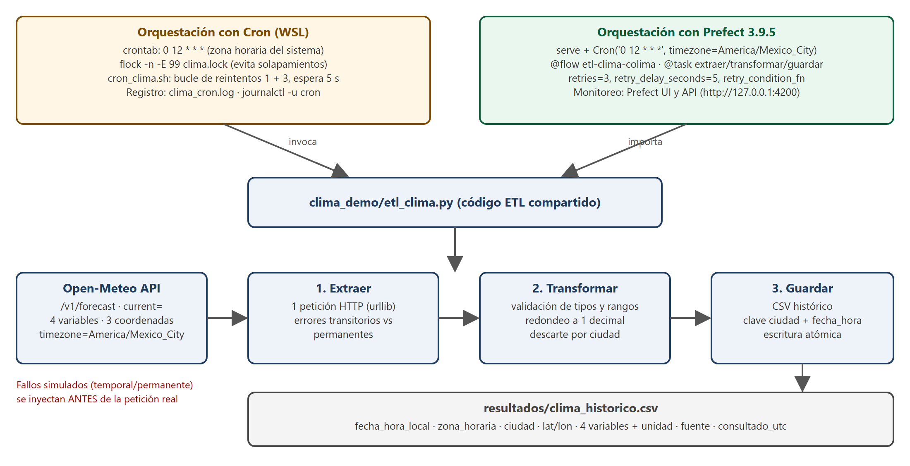{width=100%}

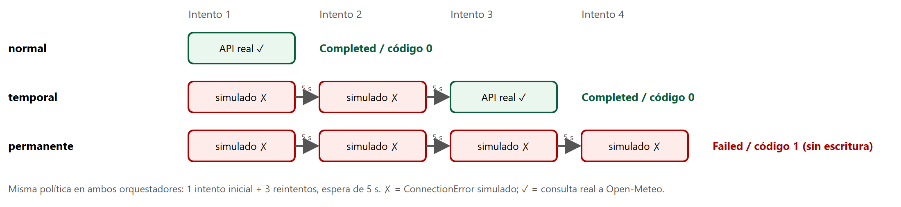{width=100%}

| Etapa | Entrada | Salida | Errores |
|---|---|---|---|
| Extraer | Coordenadas y variables | JSON crudo (3 ubicaciones) | Red, tiempo de espera, HTTP 429 y 5xx: transitorios. Otros 4xx y JSON inválido: permanentes |
| Transformar | JSON crudo | Filas validadas y redondeadas | Ciudad con valor ausente o fuera de rango: se descarta. Sin filas válidas: error permanente |
| Guardar | Filas válidas | `resultados/clima_historico.csv` | Se omiten duplicados por `(ciudad, fecha_hora_local)` |

Table: Tabla 5. Etapas del pipeline y tratamiento de errores.

# 7. Metodología e implementación

## 7.1 Entorno

Las ejecuciones se hicieron en Ubuntu 24.04 sobre WSL 2, con Python 3.12.3 y Prefect 3.9.5, y la zona horaria del sistema en `America/Mexico_City`. Las pruebas que no requieren Bash también se ejecutaron en Windows 11 con Python 3.12.10.

| Archivo | Función |
|---|---|
| `clima_demo/etl_clima.py` | ETL compartido: extraer, transformar y guardar |
| `clima_demo/cron_clima.sh` | Envoltura para Cron con reintentos manuales y registro |
| `clima_demo/flujo_clima_prefect.py` | Flujo de Prefect con reintentos automáticos y `serve` programado |
| `tests/test_clima.py` | Pruebas automatizadas, incluida una consulta real |
| `tests/generar_evidencias_clima.sh` | Regenera las evidencias 12 a 15 |

Table: Tabla 6. Archivos del caso práctico.

## 7.2 Extracción y clasificación de errores

Los escenarios de fallo se simulan **antes** de la petición. Así, todo intento que no simula un fallo consulta la API real. Las excepciones de red se convierten en `ErrorTransitorio` (se puede reintentar) y los errores de la petición o de los datos, en `ErrorPermanente` (reintentar no sirve).

```python
def simular_fallo(escenario: str, intento: int) -> None:
    if escenario == "permanente" or (escenario == "temporal" and intento <= 2):
        raise ConnectionError(f"Desconexión simulada (escenario={escenario}, intento {intento})")

def extraer(escenario="normal", intento=1, timeout=15) -> list[dict]:
    simular_fallo(escenario, intento)
    try:
        with urllib.request.urlopen(peticion, timeout=timeout) as r:
            datos = json.load(r)
    except urllib.error.HTTPError as e:
        if e.code == 429 or e.code >= 500:
            raise ErrorTransitorio(f"HTTP {e.code} de Open-Meteo") from e
        raise ErrorPermanente(f"HTTP {e.code}") from e
    except (urllib.error.URLError, TimeoutError, ConnectionError) as e:
        raise ErrorTransitorio(f"Sin conexión con Open-Meteo: {e}") from e
```

## 7.3 Validación, limpieza y almacenamiento sin duplicados

`transformar` revisa cada ciudad por separado: si una variable falta, no es numérica o está fuera de rango, descarta solo esa ciudad y registra el motivo. `guardar` combina el histórico existente con las filas nuevas, omite las claves repetidas y escribe primero en un archivo temporal que luego reemplaza al original. Así, un fallo durante la escritura no deja el CSV a medias, y repetir una ejecución (por un reintento o porque Cron y Prefect coincidan en el mismo intervalo) no duplica filas.

```python
vistas = {(f["ciudad"], f["fecha_hora_local"]) for f in existentes}
nuevas = [f for f in filas if (f["ciudad"], f["fecha_hora_local"]) not in vistas]
todas = sorted(existentes + nuevas, key=lambda f: (f["fecha_hora_local"], f["ciudad"]))
fd, tmp = tempfile.mkstemp(dir=destino.parent, suffix=".tmp")
with os.fdopen(fd, "w", newline="", encoding="utf-8") as f:
    w = csv.DictWriter(f, fieldnames=COLUMNAS); w.writeheader(); w.writerows(todas)
os.replace(tmp, destino)   # reemplazo atómico
```

## 7.4 Reintentos manuales para Cron

Cron no reintenta, así que `cron_clima.sh` implementa el bucle. El programa Python devuelve el código 75 ante un fallo transitorio y el 2 ante uno permanente. El script solo vuelve a intentar con el 75 y se detiene tras cuatro ejecuciones.

```bash
max=$((MAX_REINTENTOS + 1)); n=1
while true; do
  "$PYTHON_BIN" "$AQUI/etl_clima.py" --escenario "$ESCENARIO" --intento "$n" \
      --salida "$CSV_CLIMA" 2>&1 | tee -a "$LOG_CLIMA"
  codigo="${PIPESTATUS[0]}"
  if [ "$codigo" -eq 0 ]; then log INFO "Completado en $n intento(s)"; exit 0; fi
  log ERROR "Intento $n/$max falló con código $codigo"
  if [ "$codigo" -ne 75 ]; then log ERROR "Error no reintentable"; exit 2; fi
  if [ "$n" -ge "$max" ]; then log ERROR "Reintentos agotados: no se guardaron datos"; exit 1; fi
  sleep "$ESPERA"; n=$((n + 1))
done
```

## 7.5 Reintentos automáticos en Prefect

En Prefect, la misma política se declara en el decorador. `retry_condition_fn` evita reintentar los errores permanentes, y `task_run.run_count` le indica a la extracción en qué intento va.

```python
def es_transitorio(tarea, ejecucion, estado) -> bool:
    try:
        estado.result()
    except (ConnectionError, etl.ErrorTransitorio):
        return True
    except Exception:
        return False
    return False

@task(retries=3, retry_delay_seconds=5, retry_condition_fn=es_transitorio, log_prints=True)
def extraer(escenario: str) -> list[dict]:
    return etl.extraer(escenario, task_run.run_count)

@flow(name="etl-clima-colima", log_prints=True)
def flujo_clima(escenario="normal", salida=str(etl.CSV_PREDETERMINADO)) -> int:
    return guardar(transformar(extraer(escenario)), salida)
```

# 8. Configuración de Cron y programación recurrente de Prefect

## 8.1 Cron

La línea definitiva ejecuta el script todos los días a las 12:00 PM. `flock -n -E 99` evita que se inicie una segunda ejecución mientras la anterior sigue activa. Se agrega a la tabla del usuario **sin borrar tareas existentes**:

```bash
( crontab -l 2>/dev/null; echo '0 12 * * * /usr/bin/flock -n -E 99 "$P/resultados/clima.lock" /bin/bash "$P/clima_demo/cron_clima.sh" normal > /dev/null 2>> "$P/resultados/clima_cron.error.log"' ) | crontab -
```

Antes de instalarla se comprobó la zona horaria del sistema (`/etc/timezone`: `America/Mexico_City`). Colima usa la hora del centro, UTC−6 todo el año desde que se eliminó el horario de verano en 2022. Para obtener evidencia de una ejecución **efectiva**, sin esperar al mediodía, primero se instaló la misma línea con un minuto cercano (`45 22 * * *`). Después de verificar que el servicio cron la ejecutó, se sustituyó por la definitiva `0 12 * * *` (sección 11.4).

## 8.2 Prefect

```python
flujo_clima.serve(name="clima-diario-12pm",
                  schedules=[Cron("0 12 * * *", timezone="America/Mexico_City")],
                  parameters={"escenario": "normal", "salida": ...})
```

A diferencia de Cron, la zona horaria queda declarada en la programación y no depende del sistema. Se comprobó primero con una programación cercana (`46 22 * * *`), que Prefect ejecutó y marcó como `Completed`, y después con la definitiva, que generó la siguiente ejecución para el 26/11/2026 a las 12:00:00 PM (Figura 10).

# 9. Puntos obligatorios del profesor

## 9.1 Punto 1 — Matriz comparativa funcional

| Aspecto | Cron | Cron + `cron_clima.sh` | Prefect |
|---|---|---|---|
| Programación | `0 12 * * *`, resolución de 1 minuto | Igual | `serve` con `Cron(...)` o intervalo |
| Zona horaria | La del sistema (sin `CRON_TZ` en Debian/Ubuntu) | Igual | Explícita por programación |
| Dependencias entre etapas | Las que programe el comando | Orden y códigos revisados en Bash | El flujo pasa los resultados entre tareas y no ejecuta las dependientes si una falla |
| Manejo de errores | Código de salida; nadie reacciona | Distingue transitorio (75) de permanente (2) | Excepción convertida en estado `Failed`; `retry_condition_fn` |
| Reintentos | Ninguno | Bucle propio: 1 + 3, espera 5 s | `retries=3, retry_delay_seconds=5` |
| Monitoreo | Correo (`MAILTO`) o archivos | `clima_cron.log`, `journalctl -u cron` | Interfaz web, estados y registros por tarea |
| Solapamiento | No lo evita | `flock -n -E 99` | Un proceso `serve` por deployment (`limit` opcional) |
| Infraestructura | Servicio cron | Cron y Bash | Python ≥ 3.11, Prefect, servidor y proceso `serve` activos |
| Uso recomendado | Tareas aisladas que toleran perder una ejecución | Pocas tareas en un servidor Linux | Flujos con varias etapas, recuperación y trazabilidad |

Table: Tabla 7. Matriz comparativa funcional entre Cron y Prefect.

## 9.2 Punto 2 — Análisis de contingencia: desconexión temporal a medianoche

Supóngase que el proceso está programado a medianoche (`0 0 * * *`) y que internet se cae durante unos segundos justo en ese minuto. En el caso práctico, la hora es las 12:00 PM, pero el razonamiento es el mismo.

1. **Cron sin reintentos.** La consulta falla y el proceso termina con un código distinto de cero. Cron no vuelve a intentarlo: la siguiente oportunidad llega 24 horas después. El día queda sin datos, y si no hay correo configurado ni nadie revisa los registros, el fallo pasa inadvertido.
2. **Cron con `cron_clima.sh`.** El script registra el fallo, espera 5 s y repite la consulta, hasta cuatro intentos. Si la red regresa, se guardan datos reales de ese día; si no, termina con código 1 sin escribir en el histórico (Figura 11).
3. **Prefect.** La tarea `extraer` pasa a `AwaitingRetry` y se reintenta automáticamente. Cada intento queda en el registro de la tarea (Figura 7). Si se recupera, `transformar` y `guardar` continúan; si se agotan los intentos, la tarea y el flujo quedan en `Failed` y las tareas dependientes no se ejecutan (Figuras 8 y 9).

**Límite común:** con tres esperas de 5 s solo se cubren unos 15 segundos de desconexión, un valor adecuado para la demostración. En producción convendría una espera creciente, por ejemplo `retry_delay_seconds=[60, 300, 900]`, que cubre unos 21 minutos. Además, ningún orquestador se ejecuta si el equipo está apagado o, en el caso de Prefect, si el proceso `serve` no está activo.

## 9.3 Punto 3 — Reintentos manuales frente a automáticos

| Criterio | Manual (Cron + Bash) | Automático (Prefect) |
|---|---|---|
| Código necesario | Bucle, contador, espera, registro y códigos de salida (≈ 35 líneas en `cron_clima.sh`) | Tres argumentos del decorador y una función de condición |
| Conteo de intentos | Variable `n` que se pasa con `--intento` | `task_run.run_count`, administrado por Prefect |
| Errores no reintentables | Convención de códigos (75 frente a 2) | `retry_condition_fn` sobre la excepción real |
| Visibilidad | Líneas en un archivo de registro | Estado por intento en la interfaz web y en la API |
| Tareas dependientes | Hay que impedir explícitamente que se ejecuten | Prefect no las inicia si la tarea falla |
| Riesgo | Errores en el script (códigos de `tee`, señales, rutas) | Depende de que el servidor y el proceso estén activos |

Table: Tabla 8. Comparación de reintentos manuales y automáticos.

En ambos casos, `retries=3` (o `MAX_REINTENTOS=3`) significa tres reintentos **adicionales** al intento inicial, es decir, hasta **cuatro** ejecuciones. Así lo muestran las Figuras 9 y 11 en el escenario permanente.

# 10. Resultados

## 10.1 Tres escenarios

| Escenario | Cron (`cron_clima.sh`) | Prefect | Datos guardados |
|---|---|---|---|
| normal | 1 intento, código 0 | 1 intento, `Completed` | Sí, 3 ciudades (consulta real) |
| temporal | 3 intentos, código 0 | 3 intentos, `Completed` | Sí, en el intento 3 (consulta real) |
| permanente | 4 intentos, código 1 | 4 intentos, `Failed`, código 1 | No |

Table: Tabla 9. Resultados de los tres escenarios en ambos orquestadores (evidencias 12, 13 y 18).

En el escenario temporal con Prefect, los intentos se registraron a las 23:04:49, 23:04:54 y 23:04:58, y el tercero recibió las tres ubicaciones de la API (Figura 7). En el permanente, la tarea `extraer` terminó en `Failed` con `Run Count` 4, y `transformar` y `guardar` no llegaron a ejecutarse (Figuras 8 y 9).

## 10.2 Datos meteorológicos reales obtenidos

| Fecha y hora local | Ciudad | Temperatura (°C) | Humedad (%) | Precipitación (mm) | Viento (km/h) | Orquestador |
|---|---|---|---|---|---|---|
| 2026-11-25 22:45 | Colima | 23.4 | 94 | 0.0 | 0.9 | Cron (ejecución programada) |
| 2026-11-25 22:45 | Villa de Álvarez | 22.7 | 89 | 0.0 | 1.4 | Cron (ejecución programada) |
| 2026-11-25 22:45 | Manzanillo | 25.4 | 86 | 0.0 | 7.8 | Cron (ejecución programada) |
| 2026-11-25 23:00 | Colima | 23.3 | 94 | 0.0 | 0.6 | Prefect (escenario normal) |
| 2026-11-25 23:00 | Villa de Álvarez | 22.6 | 89 | 0.0 | 1.2 | Prefect (escenario normal) |
| 2026-11-25 23:00 | Manzanillo | 25.2 | 86 | 0.0 | 7.6 | Prefect (escenario normal) |

Table: Tabla 10. Filas del histórico `resultados/clima_historico.csv` (datos reales de Open-Meteo).

Manzanillo, en la costa, registró la temperatura y el viento más altos, mientras que Colima y Villa de Álvarez, contiguas, tuvieron valores parecidos. No hubo precipitación. El escenario temporal de Prefect se ejecutó dentro del mismo intervalo de 15 minutos que el normal: obtuvo las mismas lecturas y las omitió como duplicadas ("0 filas nuevas, 3 duplicadas omitidas"), lo que confirma que el histórico es idempotente.

## 10.3 Pruebas automatizadas

| Conjunto | Entorno | Resultado |
|---|---|---|
| `tests/test_clima.py` (8 pruebas, incluye consulta real) | WSL (Linux) | 8 aprobadas |
| `tests/test_clima.py` | Windows 11 | 7 aprobadas, 1 omitida (requiere Bash de Linux) |
| Demostración base (`test_cron`, `test_prefect`) | WSL (Linux) | 15 aprobadas |

Table: Tabla 11. Resultados de las pruebas automatizadas.

Las pruebas de `test_clima.py` cubren la conservación de ciudad, unidades y fuente; el descarte de valores inválidos; el error cuando ninguna fila es válida; el histórico sin duplicados; la simulación de los escenarios; la clasificación de errores HTTP (429 y 503 transitorios, 400 permanente); el agotamiento de cuatro intentos en `cron_clima.sh`, y una consulta real a la API.

# 11. Evidencias gráficas y de funcionamiento

Las Figuras 3 a 10 son capturas de la interfaz de Prefect (servidor local `http://127.0.0.1:4200`), tomadas con Microsoft Edge sin interfaz mediante el protocolo DevTools (`reporte/figuras/capturar.mjs`), después de ejecutar los tres escenarios. Las Figuras 11 a 17 muestran salidas reales de terminal y del CSV, copiadas sin modificar de `evidencias/` y renderizadas como imagen. Las rutas del proyecto se sustituyeron por `<proyecto>`.

## 11.1 Monitoreo en la interfaz de Prefect

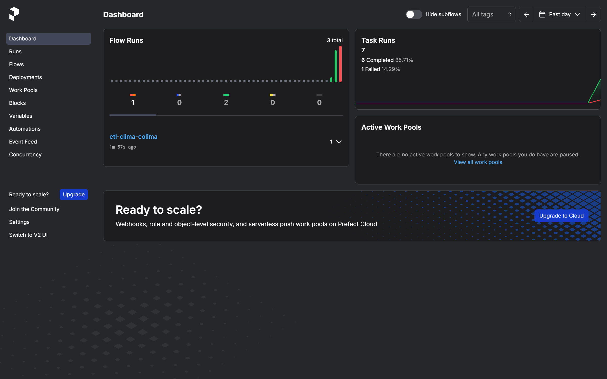{width=100%}

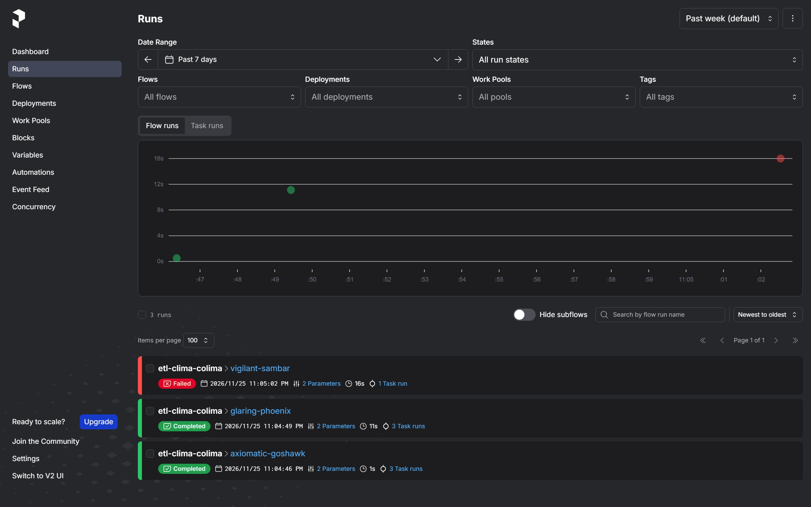{width=100%}

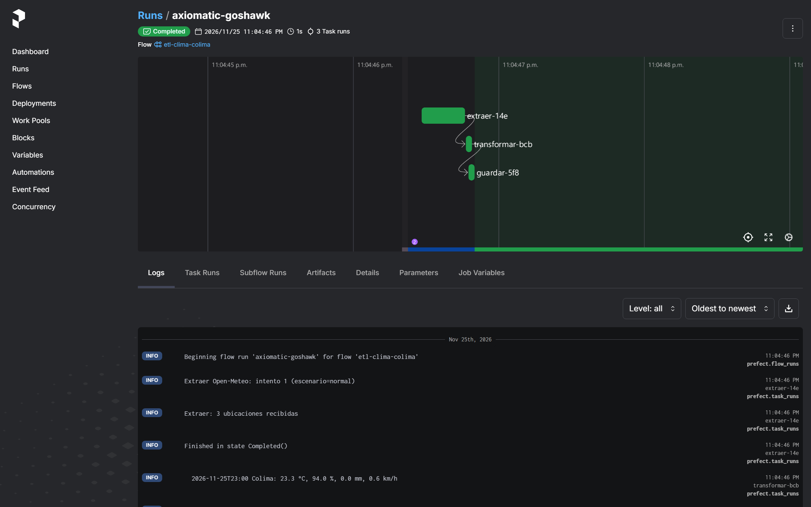{width=100%}

## 11.2 Recuperación ante desconexión temporal

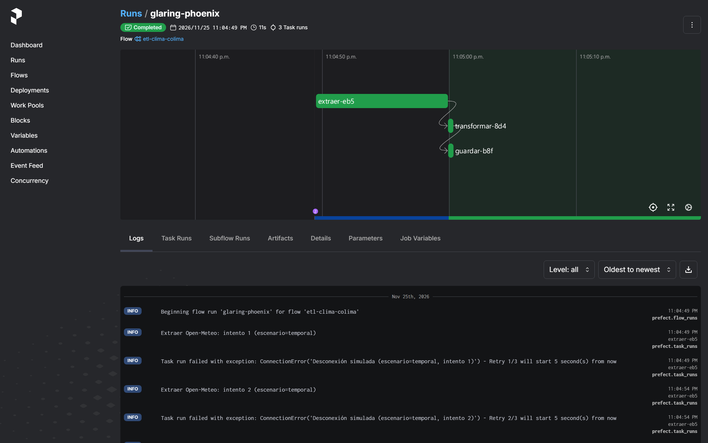{width=100%}

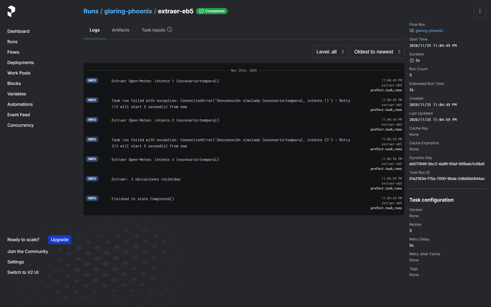{width=100%}

## 11.3 Fallo permanente

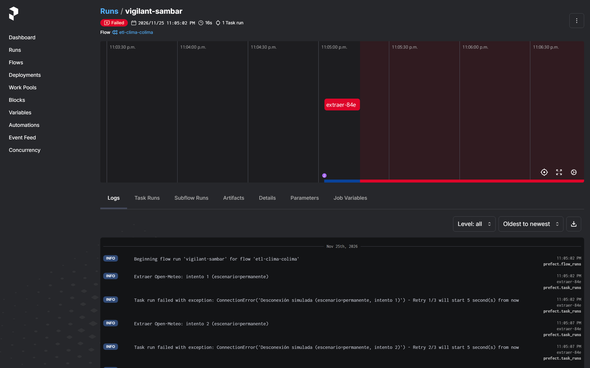{width=100%}

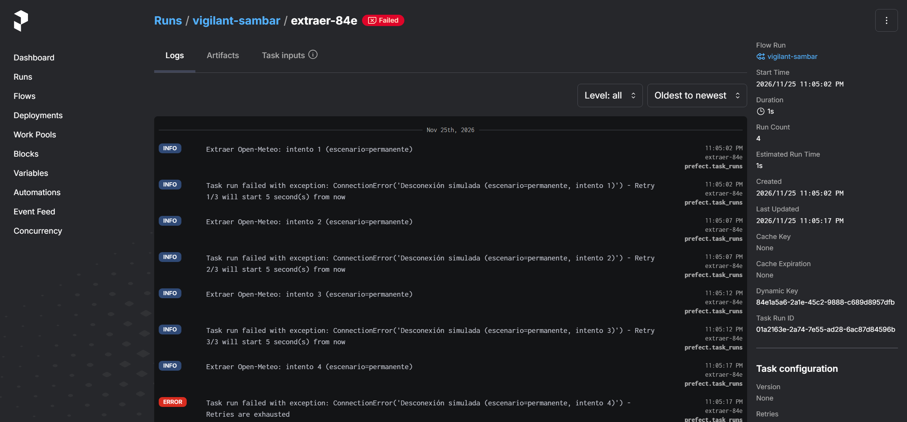{width=100%}

## 11.4 Programación recurrente

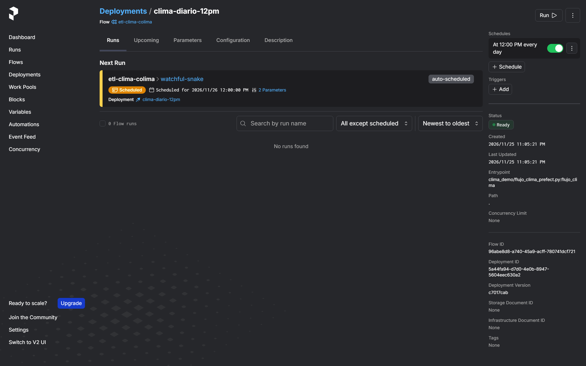{width=100%}

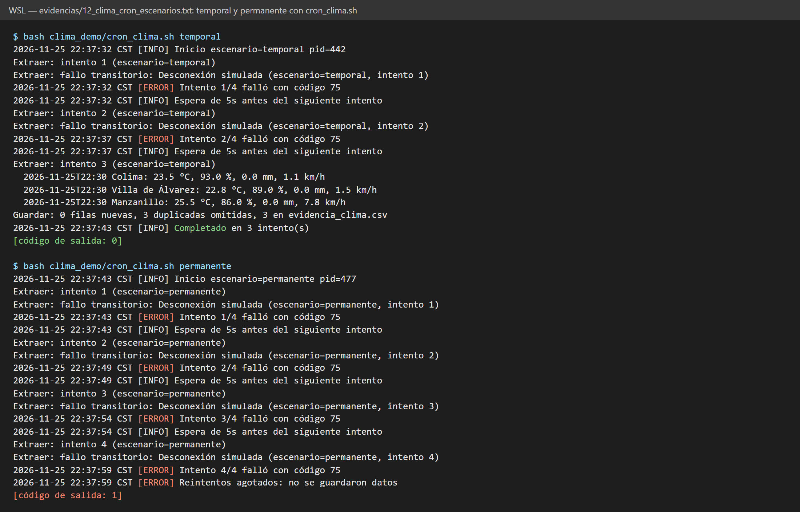{width=100%}

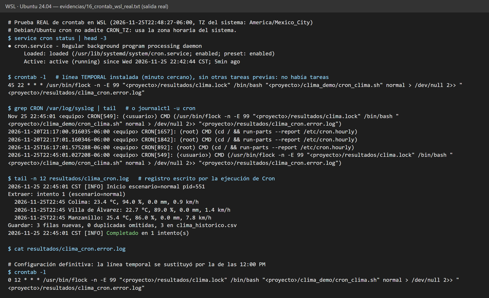{width=100%}

## 11.5 Datos almacenados

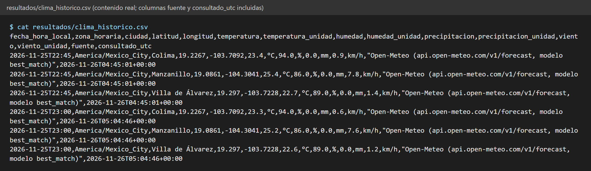{width=100%}

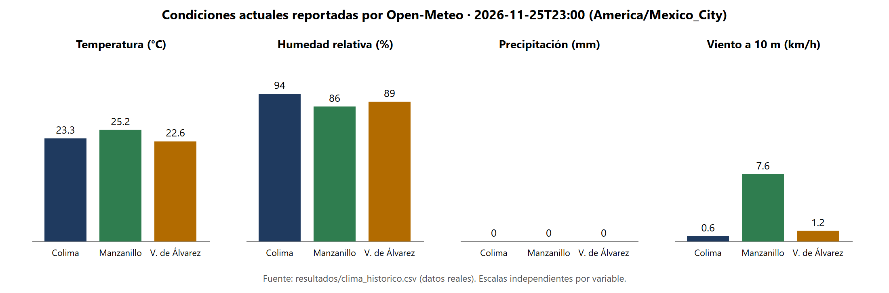{width=100%}

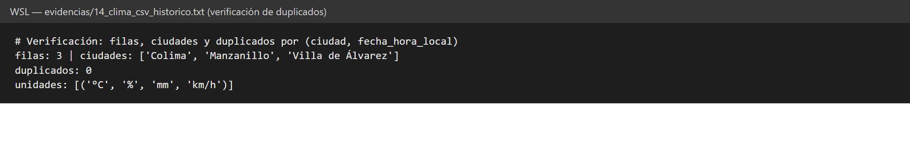{width=90%}

## 11.6 Pruebas automatizadas

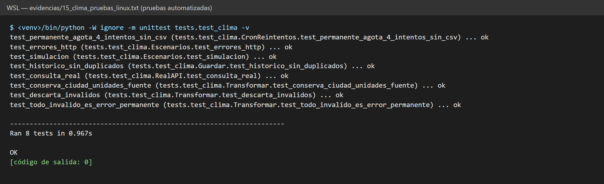{width=100%}

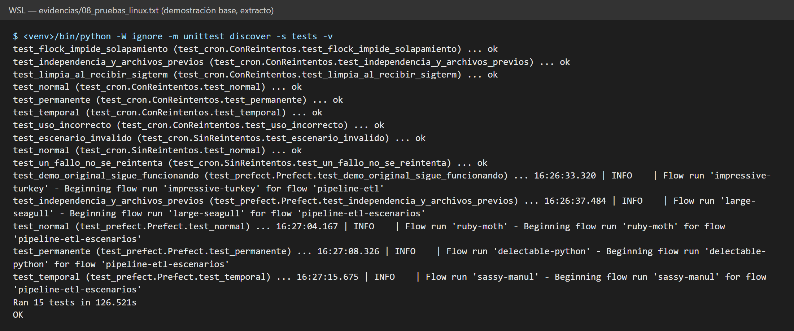{width=100%}

**Evidencias no obtenidas.** No se esperó a un mediodía real: la ejecución programada se comprobó con minutos cercanos y la programación definitiva, con `crontab -l` y con la siguiente ejecución registrada por Prefect. No hay capturas de una consulta real a Reddit, porque el equipo no dispone de credenciales.

# 12. Limitaciones

- Los fallos de red son **simulados** para hacerlos reproducibles. No se desconectó físicamente el equipo.
- El dato "actual" de Open-Meteo proviene de un modelo con resolución de 15 minutos, no de una estación meteorológica. Las coordenadas guardadas son las de la celda del modelo.
- Cron en WSL solo funciona mientras la distribución está activa. Prefect requiere además que el servidor y el proceso `serve` sigan en ejecución.
- La política de reintentos (3 × 5 s) cubre desconexiones breves. Para caídas largas se necesitan esperas mayores.
- El uso gratuito de Open-Meteo es no comercial y limitado a 10 000 llamadas diarias, un límite muy por encima de la llamada diaria de este pipeline.

# 13. Conclusiones

Ambos orquestadores ejecutaron el mismo ETL real y se recuperaron de la desconexión temporal con el mismo número de intentos, porque se les dio la misma política. La diferencia está en quién hace el trabajo. Con Cron, el reintento, el conteo, la distinción entre errores y el registro son código propio que hay que escribir, probar y mantener. Con Prefect, esa lógica se declara en el decorador, y cada intento queda visible con su estado en la interfaz web. Prefect, además, declara la zona horaria en la programación y no inicia las tareas dependientes cuando una falla.

A cambio, Prefect exige mantener activos un servidor y un proceso, mientras que Cron solo necesita un servicio que ya viene en el sistema. Para una consulta diaria aislada, Cron con un script de reintentos es suficiente; cuando hay varias etapas y se necesita saber qué falló, en qué intento y por qué, Prefect resulta más adecuado. El cambio a Open-Meteo permitió demostrar todo esto con datos reales y verificables por cualquier integrante, sin depender de credenciales.

# 14. Repositorio y estructura del proyecto

Repositorio del equipo: <https://github.com/Leslie581/Sesion49_Equipo3_Prefect> (rama `feature/sesion49-open-meteo`).

```text
Sesion49_Equipo3_Prefect/
├── clima_demo/            caso principal: ETL Open-Meteo (Cron y Prefect)
│   ├── etl_clima.py       extraer, transformar y guardar (biblioteca estándar)
│   ├── cron_clima.sh      reintentos manuales para Cron
│   └── flujo_clima_prefect.py   @flow/@task, reintentos y serve 12:00 PM
├── cron_demo/             demostración base con Cron y crontab.example (línea F)
├── reddit_demo/           ejemplo opcional de Reddit (requiere credenciales)
├── demo_prefect*.py       demostración base de Prefect
├── docs/                  comparativa Cron frente a Prefect
├── tests/                 pruebas y generadores de evidencias
├── evidencias/            salidas reales (01 a 18)
├── reporte/               este reporte (MD, DOCX, PDF) y sus figuras
└── resultados/            CSV y registros generados (no versionados)
```

# Referencias

- Open-Meteo. (s. f.). *Weather Forecast API*. <https://open-meteo.com/en/docs>
- Open-Meteo. (s. f.). *Terms and Privacy*. <https://open-meteo.com/en/terms>
- Prefect Technologies. (s. f.). *Prefect documentation*. <https://docs.prefect.io/>
- Prefect Technologies. (s. f.). *How to configure task retries*. <https://docs.prefect.io/v3/how-to-guides/workflows/retries>
- Prefect Technologies. (s. f.). *Run flows in local processes (serve)*. <https://docs.prefect.io/v3/how-to-guides/deployment_infra/run-flows-in-local-processes>
- Linux man-pages project. (s. f.). *crontab(5)*. <https://man7.org/linux/man-pages/man5/crontab.5.html>
- Linux man-pages project. (s. f.). *flock(1)*. <https://man7.org/linux/man-pages/man1/flock.1.html>
- PRAW. (s. f.). *Authenticating via OAuth*. <https://praw.readthedocs.io/en/stable/getting_started/authentication.html>
